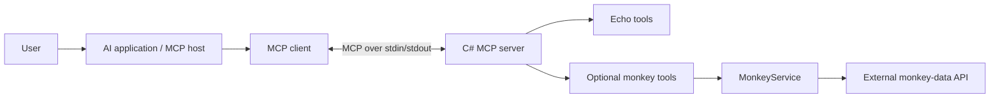

# C# MCP Server

A Model Context Protocol (MCP) server built with C# and .NET, following Microsoft's guide: [Build a Model Context Protocol (MCP) server in C#](https://devblogs.microsoft.com/dotnet/build-a-model-context-protocol-mcp-server-in-csharp/).

## Overview

This project explores how an AI application can discover and invoke C# tools through MCP. The server uses standard input/output (stdio) to communicate with an MCP-compatible client, such as Visual Studio Code with GitHub Copilot.

The server provides the tools; the connected AI application interprets user requests and coordinates tool execution. The server itself does not run an AI model.


## Features

- Local MCP communication through stdio.
- Tool discovery through C# attributes and assembly scanning.
- Echo and reverse-echo tools.
- Optional monkey-data API integration.
- Dependency injection through .NET hosting.
- Diagnostic logging to standard error, separate from MCP protocol output.

## Technology stack

| Technology | Purpose |
| --- | --- |
| C# and .NET | Server implementation and runtime |
| MCP C# SDK | MCP communication and tool registration |
| Microsoft.Extensions.Hosting | Application hosting and dependency injection |
| Microsoft.Extensions.Http | HTTP client support for the optional API extension |
| VS Code / GitHub Copilot | Example MCP client environment |

The original guide uses a preview SDK. Exact package versions and available APIs depend on the project's package references.

## Architecture



### Plain-text view

```text
User
  |
  v
AI application / MCP host
  |
  v
MCP client
  |
  | Standard input/output
  v
C# MCP server
  |-- Echo tools
  `-- Optional monkey tools --> MonkeyService --> External API
```

## Tools

The names below are C# method names. The client-discovered identifiers may differ depending on the SDK configuration.

| Tool method | Input | Description |
| --- | --- | --- |
| `GetMonkeys` — optional | No user-supplied input | Returns the monkey list as JSON. |
| `GetMonkey` — optional | `name`: string | Returns a matching monkey as JSON, or JSON `null` if no match exists. |


## Security and limitations

- This is a learning project, not a claim of production readiness.
- Tool inputs should be treated as untrusted and validated appropriately.
- Protected backend operations still require authentication and authorization.
- Tools that modify records or trigger financial operations need appropriate permission and approval controls.
- The optional monkey-data extension depends on an external service and uses an in-memory cache.

## Reference and attribution

Based on [Build a Model Context Protocol (MCP) server in C#](https://devblogs.microsoft.com/dotnet/build-a-model-context-protocol-mcp-server-in-csharp/), published on the Microsoft .NET Blog on April 7, 2025.

For SDK documentation, see the [MCP C# SDK repository](https://github.com/modelcontextprotocol/csharp-sdk).
